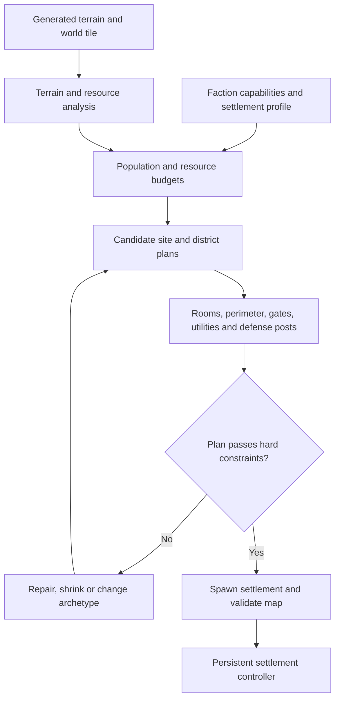
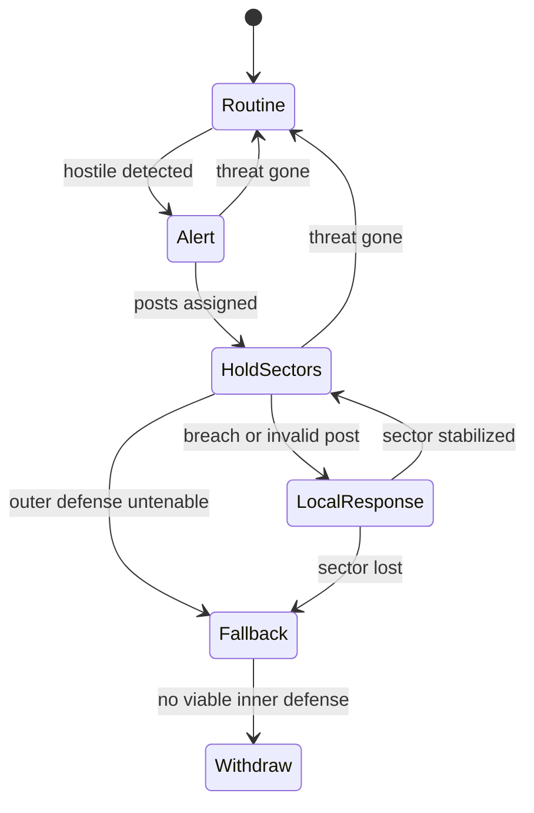

# Realistic Bases: high-level design and feasibility

2026-09-14 · Revised 2026-09-20 · Baseline: RimWorld 1.6, initially Core without DLC

## 1. Recommendation

Build a **terrain-aware settlement planner with a separate settlement controller**. Generate a settlement from its population, faction capabilities, environment, resource budget, and defensive doctrine. Buildings should be the spatial expression of those needs. Furnishing a random collection of rooms is insufficient.

The requested generation and defenses are feasible in principle. Mountain excavation and island access need careful map validation. The largest engineering risk is autonomous NPC operation: food production, hauling, refueling, ammunition manufacture, needs, and defensive duty must coexist. This requires custom NPC job selection and runtime testing, not just map generation.

Use a staged release: first a playable supplied settlement, then an MVP with best-effort operation over a bounded encounter horizon, consistent trade stock, and persistent consequences. Following the user’s 2026-09-20 scope revision, full long-term sustainability and its seasonal/multiple-harvest tests are **post-MVP**. The provisional target is three in-game days of routine supplies, with a separate declared combat duty budget. See [MVP supply and trade scope](supply-and-mvp-scope.md) for the current contract and deferred work.

This is a source-informed feasibility assessment, not a claim that the design already works in-game. Verified behavior and remaining experiments are recorded in [research notes](research-notes.md); delivery gates are in the [implementation plan](implementation-plan.md).

## 2. Requirements and scope decisions

| Requirement | Proposed behavior | Delivery |
|---|---|---|
| Procedural settlements | Variable districts, footprints, circulation, room sizes, furnishings, gates, and defenses; deterministic for fixed inputs | First playable version |
| Reflect tile properties | Inspect actual generated terrain, rock, roofs, fertility, water, access, and climate | First playable version |
| Geological Landforms | Preserve its map output; optional adapter for metadata and per-cell biome information | Compatibility milestone |
| Mountain and lake bases | Mountain foothold first; excavated mountain and accessible island/lakeshore archetypes later | Terrain milestone |
| Wall with gates and up to three levels | Interpret “levels” as **one to three physical wall layers**, with materials chosen per layer or coherent section; no vertical floors | Baseline enclosure first; full exterior layering in P4B |
| Appropriate local/imported materials | Local material palette plus a bounded, capability-dependent import budget | First playable version; imports refined later |
| All usual facilities | Housing, jail, food preparation/preservation, farming, power where applicable, recreation, workshops, storage; add medical space | First playable version |
| Personal munitions | Faction-appropriate weapons, armor, and selected carried combat equipment; ammunition only for systems that consume it | First playable version; ammo-mod adapter later |
| Turrets, cover, mortars and shell variety | Only equipment the settlement can operate, staff, supply, and afford; uranium slug turrets eligible from high industrial | P4B coordinated placement; P5 budgets; P6 specialized mortar tactics |
| Energy and shell accumulation | Real stored energy and finite supplies cover the encounter; feasible support jobs consume real inputs | Encounter readiness in MVP; sustained production post-MVP |
| Settlement trade stock | Trade goods reflect this settlement’s actual offer, separately from operating reserves; one quantity/ownership record | P5, supported ordinary item types first |
| Settlement specialization | Agriculture/industry first; evaluate mining, ranching, forestry, trade, military, medical and research profiles; verify feasibility of influencing offered products while preserving canonical stock and saved identity | P7, final planned step after MVP |
| Defenders hold position | Sector defense, limited pursuit, reserves, local fallback, and needs relief | First playable version |
| No traps or IEDs | Hard content invariant, including inherited generation and fallback paths | Every milestone |

For the MVP, “autonomous” means best-effort routine/support behavior backed by finite reserves for a declared encounter horizon, without player work orders or free refills. Long-term self-sufficiency is not an MVP gate. The provisional three-day horizon is a design target to calibrate, not a measured player visit duration or a promise against arbitrary destruction. P3 remains the first playable encounter; P6 remains the MVP release gate after revised P5.

A tribal settlement on an ice sheet may have no viable local food/fuel economy. Reduce its population, classify it as dependent on supplies, or reject that layout. Do not invent tribal refrigeration, hydroponics, or unlimited food to hide the problem. The generator should report estimated encounter coverage, supply dependencies, and unverified production assumptions; reserve size alone must not be labelled proof of local self-sufficiency.

The first release changes newly generated ordinary humanlike faction settlements. Existing loaded maps, player colonies, quest sites, ruins, mechanoid/insect settlements, and special DLC maps retain their own generation unless explicitly supported later. Multiplayer support, global faction warfare, vertical construction, and a new ammunition system are outside the initial release.

## 3. What the reference mods establish

| Reference | Observed approach | Consequence for this design |
|---|---|---|
| Vanilla Base Generation Expanded | The inspected 1.6 XML uses KCSG settlement/layout definitions, faction-specific structure selections, room count ranges, and defense/stockpile options. Its metadata requires Vanilla Expanded Framework. | It already supplies procedural variety through assembled layouts. Our differentiator must be measurable functional constraints and terrain adaptation, not simply “procedural generation.” [Definitions](https://github.com/Vanilla-Expanded/VanillaBaseGenerationExpanded/blob/400def9c829ae375e150b8c79f13af649913e0b6/1.6/Defs/SettlementDefs/Outlanders.xml) |
| Large Faction Bases | Source expands BaseGen generation, adjusts force/size with progression, includes power connection logic, and contains trap/IED generation. Both inspected custom defender graphs retain transitions to assault. | Learn from its generation and defender extension points, but do not reuse its defense chain unchanged. [Generator](https://github.com/emipa606/LargeFactionBases/blob/3d4ad947d6b694aee9cb92471b5e581f177f670e/Source/LargeFactionBase/LargeFactionBase/GenStep_LargeFactionBase.cs), [defender graph](https://github.com/emipa606/LargeFactionBases/blob/3d4ad947d6b694aee9cb92471b5e581f177f670e/Source/LargeFactionBase/RimWorld/LordJob_DefendBase2.cs) |
| Geological Landforms | Its 1.6 worker participates in elevation/fertility and terrain mutation; it also has generation-context and scatterer patches. | Generate after relevant terrain steps, inspect the resulting cells, and test generation order. A landform label alone cannot establish buildability or access. [Worker](https://github.com/m00nl1ght-dev/GeologicalLandforms/blob/e8035e2b2fdb46ceb92aa159e17e72fdc5dcc421/Sources/GeologicalLandforms/World/TileMutatorWorker_Landform.cs) |

This is a targeted source review, not a gameplay comparison or full audit of Vanilla Expanded Framework/KCSG. The references do not establish that all of their settlements fail operational checks; we have not run those measurements.

The supplied guides are useful design input: prioritize short routes between related facilities, separate hazardous storage, and use natural terrain in defenses. Their tactical recipes are not a specification. The defense page explicitly flags outdated content for 1.6, so validate mechanics against the installed game. [Colony guide](https://rimworldwiki.com/wiki/Colony_Building_Guide), [defense guide](https://rimworldwiki.com/wiki/Defense_structures)

## 4. Generation architecture

### 4.1 Inputs and reproducibility

Create a versioned `SettlementProfile` containing faction identity, capabilities, intended population, prosperity, trade access, specialization, defense budget, and supply policy. Tech level supplies defaults; explicit faction profiles and available defs refine them. A modded medieval faction should not receive industrial machinery just because an enum comparison was too broad.

Seed generation from stable world seed, tile identity, settlement identity, generator version, and the saved profile/settings snapshot. Use independent deterministic random streams for terrain selection, layout, materials, residents, and loot, with stable ordering of candidates. Ambient random calls or current player wealth must not reroll an already established base. Pin both mod set and settings for reproducibility tests; identical results across arbitrary mod updates are not promised.

Keep planning independent of map mutation. A `SettlementPlan` describes cell use, excavation, supports, rooms, doors, utilities, stock locations, posts, and expected capacities. It can be validated and visualized before expensive spawning.

### 4.2 Terrain analysis and site selection

Analyze cells for passability, terrain affordances, fertility, water/depth, natural rock, ores, roof type, existing structures, geysers, and edge access. Use seasonal temperature/light estimates and the relevant local biome rules for growing. Distinguish a buildable site from a traversable site.

Evaluate a bounded set of sites and archetypes. Score usable area, food potential, perimeter cost, access to resources, defensible approaches, excavation cost, and disruption to the landform. Use hard exclusions before scoring: unsupported foundations, blocked arrival/exit, unsupportable roofs, or insufficient required facility capacity cannot be offset by a good scenic score.

| Archetype | Placement rule | Key limitation |
|---|---|---|
| Walled village/town | Fit irregular districts to connected buildable land; retain useful farmland | Must reserve room for actual agriculture and circulation |
| Mountain foothold | Place against rock, close exposed approaches, use a small carved store/core | Requires separate validation of cave routes behind the perimeter |
| Excavated mountain base | Carve connected rooms/corridors inside existing rock, retain roof support and mountain outline | Same map under mountain roofs; not another floor or underground world layer |
| Lakeshore/peninsula fort | Use existing water to reduce exposed approaches; gate on the landward route | Shallow water may slow attackers rather than block them |
| Island/lake-enclosed base | Select existing sufficiently large land with a legal approach or feasible causeway/bridge | No deep-water bridge assumption; reject inaccessible sites |

Do not create a lake or flatten a mountain merely to force a preferred archetype. Bounded excavation and legally supported bridges are deliberate plan actions, accounted for in the resource budget. A lake-enclosed base is conditional on the generated landform; it cannot be promised on every tile.

Arrival validation is specific to the supported entry mode. For a caravan, prove usable edge staging and access to at least one assaultable gate or wall. Closed hostile doors are legitimate obstacles; water that makes every attack route impossible is not. Validate retreat access separately. Transport pods and DLC entry modes need their own tests.

### 4.3 Districts, rooms, and circulation

Derive room demand from population and workload. Build an adjacency graph before packing footprints:

- Food flow: fields → raw-food storage → kitchen → meal storage/dining. Give the kitchen a side entrance so it is not a through-corridor.
- Production flow: bulk storage → workshop → finished storage; reserve both bench interaction cells and hauling space.
- Daily life: housing near dining/recreation, with medical and prisoner support reachable from protected internal routes.
- Defense supply: workshops/armory → separated magazines → covered resupply routes → posts and mortar court.
- Utilities: locate generating equipment where it can actually work; route power and heat around the rooms rather than adding it as decoration.

Use procedural room envelopes and rule-based furnishing. Small templates may encode a valid cooler arrangement or mortar position, but should not determine an entire settlement. Variation comes from environment and demand as well as randomized style.

### 4.4 Validation and fallback

Validate the plan before spawning, then validate the realized map after generation finishes. Check map bounds, terrain support, roof support, door operation, interaction cells, faction-relative reachability, perimeter closure, firing arcs, power connectivity, actual supply placement, and the absence of traps.

Repair locally, then reduce optional buildings/defenses and population together, then try another archetype. Bound attempts by deterministic work counts. A fallback must be a tested, compact, trap-free settlement with the same validation contract. Never silently call an unfiltered vanilla/reference defense resolver, since it could introduce prohibited content.

If even the compact plan cannot fit, use the integration spike's tested map-generation recovery path and record the tile as unsupported. Do not spawn half a settlement, teleport arriving pawns into water, or loop indefinitely. Defining that recovery path is a release blocker.

## 5. Faction, materials, and perimeter

Capabilities should separately describe electricity, refrigeration, hydroponics, machining, mortar operation, shell manufacture, advanced imports, and equipment preferences. Faction tech level alone does not prove every research-dependent technology is available. Do not read the player's research tree as the NPC faction's research progress.

| Profile | Construction and life support | Defense defaults |
|---|---|---|
| Tribal/neolithic | Local wood/stone where plausible; shared housing, fueled cooking, preserved-food stores, outdoor crops where viable | Bows and melee weapons, local-material cover, guarded gates; no electric turrets or mortars |
| Medieval, when supplied by a faction mod | Stone emphasis, faction-defined workshops, improved housing/storage | Appropriate ranged/melee equipment and layered fortification; artillery only via an explicit integration |
| Industrial | Electric or fueled cooking, refrigeration, climate control, workshops; hydroponics only where supported and affordable | Firearms/armor, turrets, barricades/sandbags, mortars when staffed and supplied |
| Advanced/spacer | Better equipment, reliable utilities, protected production; bounded imports and redundancy | Stronger material sections and coordinated layered defense; DLC equipment remains opt-in |

Use actual build compatibility and stuff-dependent stats. Score material by effective hit points, flammability, local availability, cost, and faction preference. Higher tech does not automatically make a steel wall a sensible upgrade over stone. Choose a coherent small palette, not a different material on every wall tile.

Local supply is an estimate of what an established settlement could have obtained from that tile, not a requirement that its historical building materials still exist as unmined deposits. Imports require a recorded value/quantity budget and plausible trade capability; use them preferentially for gates, exposed sectors, and critical rooms before an entire rare-material perimeter. Saved weighted choices allow variation among sensible options.

Keep wall thickness and material quality independent. One to three layers are consecutive wall cells with aligned, controllable entrances. Richer settlements may reinforce selected sectors instead of tripling the entire footprint. Natural solid rock can complete the defensive enclosure, but record this as a natural barrier; water is not automatically equivalent to a wall. Allow an all-built perimeter preference if desired.

Implement gates initially as ordinary faction-owned doors/autodoors in gatehouses. A wide gate visual is a later custom building, not a baseline engine assumption. Enforce enough internal traffic space and protected fallback routes. Standard solid walls block firing: posts belong at gate mouths, projecting positions, or purpose-designed openings. Do not generate “wall-top” shooters or expect pawns to fire through three solid wall layers.

## 6. Facilities must have operational contracts

Each facility declares what it consumes, produces, stores, needs from workers/utilities, and guarantees spatially.

| Facility | Required functional checks |
|---|---|
| Housing | Sleeping capacity for residents; accessible, roofed, tolerable temperature; medical/prison beds do not count as normal housing |
| Jail/prison | Secure room, prisoner-designated sleeping capacity, food access for wardens; initially empty capacity is acceptable, spawning/caring for prisoners is a separate behavior test |
| Kitchen/butchery | Supported recipes, usable bench, ingredients, fuel/power, cook capacity; dirty processing separated from clean cooking |
| Food preservation | Industrial freezer with correct cooler orientation, exhaust path, power, and tested temperature; tribal preserved-food pantry instead of a fake freezer |
| Outdoor agriculture | Crop eligibility, fertility, light, temperature, skill, season length, access, sowing/harvest labor; food crops must feed the actual population |
| Indoor farming | Valid crop/grower combination, viable light and temperature, power peaks, startup food until harvest; do not assume every crop supports hydroponics |
| Power and batteries | Connected networks, suitable generating sites, stocked fuel, weather/night budget, charged but finite storage, service access |
| Dining/recreation | Accessible tables/seating and tech-appropriate recreation; protected needs routes during defense |
| Workshops | Actual permitted recipes, usable stations, ingredients, skilled labor, and target stock levels |
| Storage | Capacity and filters appropriate to stocks; access aisles; separate food, fuel/explosives, medical supplies, and bulk goods |
| Medical support | Beds, medicine, reachable supplies, available tending role; capability appropriate to faction |

### 6.1 Food, fuel, and labor accounting

Use a resource-flow graph. For each resource, compare supply, consumption, reserve, and throughput. Include cooking ingredients, preservation losses, crop downtime, climate, sow/harvest/haul work, and workers temporarily assigned to defense. Avoid a circular budget in which the same harvest feeds residents and becomes generator fuel twice.

Conceptually, daily food demand is the sum of residents' nutrition requirements. Required cultivated area follows from **effective edible nutrition per cell per day**, after actual harvest and preparation assumptions. Raw plant `growDays` is not a promise of that many calendar days to harvest. A field that technically supports a crop may still fail a winter survival budget.

For the MVP, edible startup stocks cover the declared encounter horizon even if no harvest finishes during the visit. If a profile relies on cooking or production within that horizon, validate its inputs and support jobs; otherwise treat production as best effort and give it no budget credit. The stronger first-harvest provision already implemented in P2 may remain. Seasonal reserves and repeated crop-cycle validation move post-MVP. Bounded prior imports may explain supplies; no delivery is assumed during an active siege. Minerals, components, and other items remain finite.

### 6.2 Power budget

Evaluate representative day/night, adverse-weather, and combat load scenarios. Include sun lamps, climate control, benches, turrets, and battery losses. Check each connected network separately. A generator near a turret is insufficient if they are not connected.

Use RimWorld's watt-days for stored energy:

`required usable energy (Wd) = integral(max(0, load W − available generation W), over time in game days) + storage losses + reserve`

For illustration only, an assumed 2,000 W deficit for half a game day requires 1,000 Wd before losses and reserve. This is a unit check, not a proposed settlement loadout. Apply charging efficiency to the input needed to replenish storage; do not apply it again to energy already stored. Validate recharge between recurring deficits within the encounter horizon, not just survival of one night; season-long energy balance is post-MVP. The inspected implementation converts watts to energy per tick and models charging efficiency/self-discharge; see evidence E6 in [research notes](research-notes.md).

Fuel generation requires both a stock horizon and refueling labor. Provide critical/noncritical load groups so an emergency policy can suspend workshops before food preservation and key defenses. Solar flares and destroyed generators should remain meaningful failures; autonomy does not confer immunity to game events.

### 6.3 Shells and other consumables

Generate finite shells, turret reload materials, fuel, and replacement barrels where the active rules require them. Derive quantities from installed equipment, planned firing duty, engagement horizon, and reload behavior. Mortars also require operators, reachable magazines, legal unroofed firing cells, and valid targets.

A stock target can be computed as `ceil(expected shots per game hour × engagement hours × reserve factor)`, then split by permitted shell type and storage capacity. Rates and factors are configuration inputs to be calibrated in-game, not invented universal constants. Manufacturing, when enabled, must have the correct recipes, ingredients, bench capacity, skill, and available workers. MVP combat reserves must cover the declared firing duty without relying on unvalidated manufacture. Full shell-production balance is post-MVP; any best-effort replenishment consumes real ingredients and work. Destroyed workshops or exhausted ingredients stop that replenishment.

Start with high-explosive shells and a bounded incendiary option with local fire/friendly-fire checks. Add EMP and smoke only with suitable targeting and loading logic. In the inspected game, NPC mortar loading rejects projectiles whose damage definition does not harm health, and NPCs do not use the player shell filter. Merely placing specialized shells does not implement their tactics (E5). Antigrain shells are disabled by default as a balance choice; no shell is ever converted into an IED.

Ordinary vanilla small arms need no bullet supply model. Give pawns appropriate weapons/armor and handle actual consumable equipment according to its defs. A Combat Extended or other ammunition adapter must supply its own caliber, magazine, reload, armor, and production rules; do not claim compatibility from successful generation alone.

### 6.4 Operating reserves and trade inventory

Treat stock as separate operating reserves and sale goods with one authoritative record of physical quantities. The same units cannot fund both budgets. The sale inventory should reflect the actual stock offered by this settlement, including imports and completed player transactions, not an unrelated random loot table. Sale goods may exceed local production capabilities without granting the faction the technology to manufacture or equip them.

Use a persisted trade-stock snapshot and reconciliation adapter for supported ordinary items. Materialize or transfer those goods to appropriate storage without keeping a second sellable copy; buying, selling, looting, destruction, consumption and re-entry update the same quantities. Retain quality, stuff and condition where applicable. Never regenerate stock merely because the map loads or a warehouse becomes empty. Exact supported-item matching, storage/value constraints, exceptional items and restock rules are specified in [MVP supply and trade scope](supply-and-mvp-scope.md). This consistency work does not require simulating a trade economy.

## 7. Defender and worker controller

Vanilla's inspected `LordJob_DefendBase` contains transitions into `LordToil_AssaultColony`, including harm, losses, elapsed time, and hunger. Replace behavior for this mod's registered garrison through a custom Lord job/duties; avoid changing all enemy pawns globally. Holding a center point is insufficient for an irregular base (E2).

Roles: ranged defenders, gate/melee reserve, mortar operators, reserve squad, and essential support workers. One pawn has one active assignment at a time. Schedule relief for food, sleep, temperature safety, and tending along protected routes. Workers suspend unsafe tasks when a sector is threatened.

Assign posts using cover, line of fire, weapon range, access, target direction, and congestion. Maintain a defended region with role-specific pursuit limits. Revalidate both destination and route: a target inside a radius can still induce a path outside the wall. Losing a post should trigger a new local post or fallback, not an unrestricted charge. A limited sortie against exposed artillery can be a later doctrine option; it is never the default response to damage.

Avoid permanent standoffs and inert defenders through limited sector repositioning, reserves against breaches, appropriate counterbattery fire, and eventual withdrawal when the position is untenable. Closed-gate defenders still need usable firing positions. Allow ordinary combat, injury, morale, and environmental consequences; no global suppression of mental states or invincibility.

For MVP daily work, prioritize needs, hauling, refueling, reload support, tending, and cooking where the food budget requires it. Growing, shell production, repair, cleaning, and prisoner support may be best-effort extensions where supported; long-term throughput balancing is post-MVP. An occupied prison still needs care during the encounter; an empty jail does not require spawning prisoners. Use a narrow settlement job selector. Reuse vanilla job drivers where their faction and ownership assumptions are satisfied. Do not simply route enemies into the colonist work tree: source includes non-colonist work gates and a grower scan over player buildings (E4).

Use actual items and normal resource consumption for loaded-map production. Do not emulate autonomy by periodically spawning finished meals and shells. Unsafe/unavailable jobs should yield to another role and produce a diagnostic when a critical operation stalls.

## 8. Persistence, compatibility, and balance

Store profile/seed/version and off-map resource summaries on a world component keyed to settlement identity. Store the live plan references, ownership, posts, tasks, inventories, and controller state on a map component; serialize Lord state through the normal save mechanism. Rebuild transient indexes and reservations on load.

An unloaded settlement should not keep its map alive merely to tick every resident. Vanilla settlements have a map-removal lifecycle (E7). MVP persistence therefore still needs a baseline plan plus bounded changes for damage, removed buildings, resources, casualties, traded goods, and looted supplies; shortening the sustainability horizon does not authorize duplicate goods or residents. Preserve pawn identities through the supported world-pawn lifecycle; never respawn killed or captured residents from the original roster.

No refill on reload or caravan re-entry. In the first playable version, save/load of a loaded encounter is required, but untested revisit persistence must be labelled unsupported. The MVP gate requires tested unload/revisit semantics. Begin with frozen off-map operating balances and no simulated production. Reconcile ordinary trade/restock events through the stock adapter, suppressing encounter-time refills and duplicates; a simulated economy or supply-convoy system remains post-MVP. Exact per-pawn off-map simulation is unnecessary for the requested encounter quality.

On capture/claim or a faction change, remove the affected pawn/building from controller ownership immediately. Never overwrite player bills, priorities, doors, or production settings after handover. Settlement defeat, map removal, retreat, and quest interactions require integration tests. Adding the mod should affect future eligible generation; removing it while custom saved components/Lords remain cannot be called safe without a migration path.

Use one generation owner per map. Detect Vanilla Base Generation Expanded, Large Faction Bases, and other replacements. Initially report them as unsupported together on the same settlement; load order is not a correctness strategy. Integration can later select one generator per settlement. Keep Geological Landforms, modded factions, DLC, and ammo changes behind optional adapters with validated versions and explicit capability fallbacks.

Budget settlement size, manpower, weapon quality, fortification, utilities, and loot separately. Enforce caps on their combination; do not multiply all of them by difficulty. Assign a stable settlement tier, show an approximate pre-attack strength/supply description, and expose size/strength/density preferences. Improved defense must leave practical approaches, breach opportunities, vulnerable utilities, and finite ammunition. Small coherent settlements should remain possible; “better” must not mean “every base is an enormous fortress.”

## 9. Feasibility verdict

| Workstream | Confidence | Main evidence or uncertainty |
|---|---|---|
| Procedural rooms, walls, gates, furnishing | High | Existing generation/def mechanisms; integration still needs a prototype |
| Terrain-aware placement and local materials | High | Actual map grids provide stronger inputs than tile labels |
| Full mountain excavation / lake enclosure | Medium | Roof support, legal bridges, and arrival connectivity need adversarial seed tests |
| Working startup power and finite supplies | High | Existing power/consumable systems can represent them; sizing must be validated |
| Encounter supplies and best-effort NPC support | Medium | Finite reserve sizing and essential support jobs require runtime checks |
| Sustained NPC economy while loaded (post-MVP) | Medium, substantial work | Full production/labor balance needs extended validation |
| Trade-stock consistency | Medium, integration spike required | Lazy stock generation, transactions and physical ownership need reconciliation |
| Holding sectors and local fallback | Medium-high | Custom Lord/duty extension points exist; battle behavior needs live tests |
| Specialized mortar shell tactics | Medium | NPC loader/targeting needs explicit support |
| Persistent off-map economy and revisits | Medium-low until prototype | Map removal, stock reconciliation, pawn identity, and loot duplication risks |

Proceed with a **small industrial settlement on an ordinary temperate map** as the first vertical slice. It should prove a working food/power layout, one closed perimeter with gates, usable cover and turrets, a physically supplied mortar, and defenders holding posts. In the same early phase, prototype one enemy cooking/refueling loop and one unload/revisit cycle; those risks should be resolved before investing in a large layout library.
